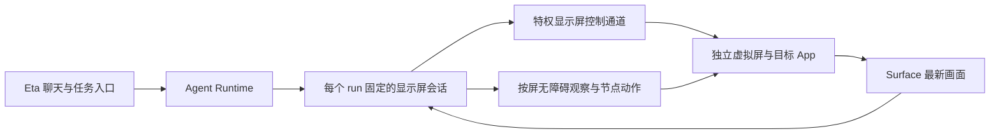

# Eta 虚拟屏与锁屏持续执行探索

调研日期：2026-10-07。本文用于决定是否进入原型开发，并为后续向 Eta 提交 PR 提供依据。

- 上游：[Mangi-11/Eta](https://github.com/Mangi-11/Eta)。
- Fork：[Costben/Eta](https://github.com/Costben/Eta)。
- 探索分支：`docs/virtual-display-exploration`。
- 源码基线：`9de3a3f70aba497bd8fd677cb5b876f45115b428`，从 `upstream/main` 建立分支。
- 本轮完成了仓库、Android 框架和 scrcpy 源码调研；设备、ROM、Root 管理器与 LSPosed 版本尚待确定，真机结果待记录。

## 1. 结论与立项条件

**值得进入小型验证原型。Android 已有独立虚拟屏、按屏操作和副屏保持解锁的机制；Eta 当前需要补齐显示屏路由。**

目标是让 Eta 的 Agent Runtime 在后台执行，将目标 App 启动到独立虚拟屏，并在主屏真正锁屏、物理屏幕关闭后继续观察和操作。虚拟屏承载目标 App，Eta 聊天界面可留在主屏。

源码依据支持这条路线，但它尚未构成特定手机上的可用性证明。建议以“锁屏后一小时内，副屏持续渲染、界面节点可读、点击和中文输入成功、主屏仍锁定”为第一轮立项门槛。

| 判断 | 证据状态 | 对开发的影响 |
| --- | --- | --- |
| Android 13 已具备独立显示组和始终解锁虚拟屏 | 已查阅 AOSP 13 | 与 Eta 的最低 Android 版本一致 |
| Android 支持按显示屏读取窗口、截图、发送手势 | 已查阅 AOSP 13/14 | 可优先复用无障碍，避免全部改成坐标操作 |
| scrcpy 已使用上述虚拟屏标志 | 已查阅固定提交 | 可参考其生命周期、系统调用和版本适配 |
| Eta 当前缺少完整多显示屏执行上下文 | 已查阅基线源码 | 创建虚拟屏与改造工具路由均属于开发工作 |
| Root 辅助进程足以覆盖目标 ROM | 待真机验证 | 创建者 UID、包名、系统权限和 SELinux 均需确认 |
| 主屏锁屏/息屏后，副屏持续工作且焦点互不干扰 | 待真机验证 | 是原型的核心验收项 |
| 长时间模型请求、进程与网络保持稳定 | 待真机验证 | 前台服务和 CPU 唤醒锁之外，还要检查 ROM 与电源状态 |

## 2. 精确定义目标

需要分别验证四种状态，避免把“物理屏幕关闭”当成“手机真正锁屏”：

| 状态 | 需要观察的行为 |
| --- | --- |
| 主屏亮着且已解锁 | 副屏能执行，主屏正常使用 |
| 主屏显示 PIN 锁屏界面 | 副屏保持自己的应用窗口，主屏认证状态保持锁定 |
| 主屏锁屏且物理屏幕关闭 | 副屏仍产生新画面，App 能响应操作 |
| 长时间静置、拔掉充电线 | 任务、网络和副屏保持可用，并记录功耗 |

本轮目标以设备开机后已完成首次解锁为前提。重启后首次解锁前的存储、密钥访问与任务恢复，需要单独设计。虚拟屏的“始终解锁”是显示屏/窗口层面的能力；App 自己读取设备锁定状态、要求生物认证或访问需要认证的密钥时，仍可能中止业务操作。

虚拟屏也是同一 Android 用户下的显示屏，不是另一台手机或独立应用沙盒。同一 App 的已有任务、账号和进程状态可能共享，应用是否支持同时出现在两块屏幕上需要单独验证。

## 3. Android 与 scrcpy 的直接依据

### 3.1 副屏保持解锁

AOSP 13 的 `DisplayManager` 声明了 `TRUSTED`、`OWN_DISPLAY_GROUP` 和 `ALWAYS_UNLOCKED`。其中 `ALWAYS_UNLOCKED` 仅适用于不属于默认显示组的虚拟屏。[A1]

`VirtualDisplayAdapter` 仅在独立显示组条件成立时，把始终解锁标志传递到显示设备；`KeyguardController.setKeyguardShown()` 遇到始终解锁显示屏会直接返回，跳过该屏的锁屏状态更新。[A3][A4]

这是一条现成系统路径：为目标虚拟屏设置正确的属性，而非修改整机锁屏判断。

### 3.2 创建者身份决定系统调用是否成立

AOSP 13 创建虚拟屏时，首先检查传入的 `packageName` 是否属于实际 Binder 调用 UID，随后检查 `ADD_TRUSTED_DISPLAY`、`ADD_ALWAYS_UNLOCKED_DISPLAY` 等权限。[A2]

因此，“App 已获得 Root 授权”“反射调用能找到方法”“辅助进程 UID 为 0”分别只说明部分条件；创建显示屏仍需验证完整调用身份。AOSP 13 的 Shell 应用声明了上述显示权限，以及输入注入、设备电源等相关权限。[A9]

scrcpy 使用归属 `com.android.shell` 的调用上下文创建虚拟屏，其正常 ADB server 运行路径是 shell 身份。直接把这段代码搬进 UID 0 的进程，存在包名与调用 UID 不匹配的问题。[S2][S3]

**对前文“先 Root，后 LSPosed”建议的细化：先验证 Root 启动、采用实际 shell UID 的辅助进程；若 ROM 或启动环境不支持，再验证 LSPosed 的系统进程桥接。两种后端的最终选择以实测结果为准。**

### 3.3 多屏无障碍与输入

Android 13 的无障碍服务提供 `getWindowsOnAllDisplays()` 和 `takeScreenshot(displayId, ...)`；手势描述可指定目标显示屏。Android 14 服务端按 `displayId` 查找输入注入器。[A5][A6]

Android 14 还提供 `OWN_FOCUS`，scrcpy 会按版本启用独立焦点相关标志。[A7][S1] 独立焦点支持值得使用，但它本身并未证明主屏输入、键盘和顶部焦点始终不受影响。

Root 的 `input -d <displayId>` 可以用于原型里的坐标动作和按键验证。[A10] `BACK`、`HOME` 等现有无障碍全局动作则需要逐项处理，因为当前调用没有显式目标屏。

### 3.4 电源与画面生命周期

独立显示组在 AOSP 电源管理中对应独立的 PowerGroup，但其状态仍由电源管理维护。[A8] 始终解锁标志处理锁屏，CPU 唤醒锁处理 CPU 休眠，前台服务维持任务生命周期，三者承担不同职责。

虚拟屏必须持有有效 Surface，并持续消费输出；消费者积压会导致画面生产阻塞。推荐保留最新画面、及时释放旧缓冲区，并按需编码给模型。原型初始可使用 `720×1280 / 320 dpi`，便于控制内存和截图开销。

scrcpy 可以证明创建虚拟屏和指定 App 的实现路径；其电脑客户端和 ADB 生命周期不宜直接成为最终手机独立运行的依赖。[S1][S2]

## 4. Eta 源码缺口与改造入口

以下位置均针对本文的固定源码基线，点击对应链接可直接核对。

| 能力 | 现有行为与源码位置 | 建议改造 |
| --- | --- | --- |
| 观察目标 | [RootShellDeviceController.kt:100](../app/src/main/kotlin/io/github/mangi/eta/agent/device/RootShellDeviceController.kt#L100)组合屏幕、焦点、节点和截图 | 观察过程使用统一显示屏会话 |
| 节点读取 | [AgentAccessibilityService.kt:142](../app/src/main/kotlin/io/github/mangi/eta/agent/accessibility/AgentAccessibilityService.kt#L142)读取 `rootInActiveWindow` | 按目标屏选择窗口，再读取其根节点 |
| 屏幕尺寸 | [AgentAccessibilityService.kt:184](../app/src/main/kotlin/io/github/mangi/eta/agent/accessibility/AgentAccessibilityService.kt#L184)读取默认屏；[RootShellDeviceController.kt:911](../app/src/main/kotlin/io/github/mangi/eta/agent/device/RootShellDeviceController.kt#L911)回退 `wm size` | 读取目标逻辑屏的尺寸、密度和旋转 |
| 无障碍截图 | [AgentAccessibilityService.kt:955](../app/src/main/kotlin/io/github/mangi/eta/agent/accessibility/AgentAccessibilityService.kt#L955)使用当前窗口集合和默认屏尺寸合成 | 按目标屏获取窗口，并保留现有浮层排除与失败语义 |
| Root 截图 | [RootShellDeviceController.kt:807](../app/src/main/kotlin/io/github/mangi/eta/agent/device/RootShellDeviceController.kt#L807)执行 `screencap -p` | 优先读取虚拟屏 Surface；需要回退时显式核对屏幕身份 |
| Root 节点回退 | [RootShellDeviceController.kt:840](../app/src/main/kotlin/io/github/mangi/eta/agent/device/RootShellDeviceController.kt#L840)调用普通 `uiautomator dump` | 验证副屏支持，避免把主屏节点作为副屏回退结果 |
| 点击和滑动 | [AgentAccessibilityService.kt:1793](../app/src/main/kotlin/io/github/mangi/eta/agent/accessibility/AgentAccessibilityService.kt#L1793)创建未指定显示屏的手势；Root 命令也未指定屏幕 | 无障碍手势和 Root 输入均绑定目标屏 |
| 文本与焦点 | [AgentAccessibilityService.kt:1255](../app/src/main/kotlin/io/github/mangi/eta/agent/accessibility/AgentAccessibilityService.kt#L1255)从当前活动窗口寻找输入节点 | 按目标屏查找输入节点；验证中文、选区、提交和剪贴板 |
| 返回/主页 | [RootShellDeviceController.kt:470](../app/src/main/kotlin/io/github/mangi/eta/agent/device/RootShellDeviceController.kt#L470)优先全局动作，随后普通 `input keyevent` | 优先验证指定屏的返回键；主页、最近任务分别探测 |
| 启动和跳转 | [AgentLocalTools.kt:702](../app/src/main/kotlin/io/github/mangi/eta/agent/tool/AgentLocalTools.kt#L702)和 [:749](../app/src/main/kotlin/io/github/mangi/eta/agent/tool/AgentLocalTools.kt#L749)直接启动 Intent | 指定启动屏幕并读回实际任务位置，跟踪外部跳转 |
| 观察与坐标合同 | [RootShellDeviceController.kt:36](../app/src/main/kotlin/io/github/mangi/eta/agent/device/RootShellDeviceController.kt#L36)的观察快照和坐标信息缺少显示屏身份 | 补充显示屏、会话代次与几何信息，并检查动作是否匹配 |
| 工具执行入口 | [AgentLocalTools.kt:102](../app/src/main/kotlin/io/github/mangi/eta/agent/tool/AgentLocalTools.kt#L102)直接创建现有设备控制器 | 增加按 run 固定的执行后端，所有 GUI 动作共用 |
| 后台任务 | [AgentExecutionService.kt](../app/src/main/kotlin/io/github/mangi/eta/agent/runtime/AgentExecutionService.kt)已有任务引用与前台通知，使用 `START_NOT_STICKY` | 复用现有租约，增加任务期间的唤醒锁和虚拟屏回收 |
| 系统桥接 | [AccessibilityProtectionHooks.kt:69](../app/src/main/kotlin/io/github/mangi/eta/hook/system/AccessibilityProtectionHooks.kt#L69)已有系统 Context 和后台 Handler 的接入方式 | 可参考生命周期接入；新增显示协议，不混用无障碍恢复协议 |

对 `app/src/main` 的检索未发现创建虚拟屏、显式指定启动显示屏、按屏枚举窗口、设置手势目标屏或 CPU 唤醒锁的实现。这个结论限定于本次源码基线。

还有一个容易遗漏的细节：Android 的逻辑 `displayId` 与 SurfaceFlinger 的显示标识不是同一种编号。AOSP 13 的 `screencap -d` 使用 SurfaceFlinger 标识；把虚拟屏逻辑 ID 直接填进去，并不足以保证截图正确。[A11]

## 5. 推荐架构与两种特权后端



### 后端 A：Root 启动 shell 身份辅助进程

利用 Root 启动可持有 Android 运行时、实际 UID 为 shell 的辅助进程，创建虚拟屏、管理 Surface，并执行按屏启动和输入。进程与显示屏保持同一生命周期，不通过每次工具调用重新创建。

优点是可借鉴 scrcpy 的 shell 调用路径，显示和画面处理留在辅助进程。待验证项包括 Root 管理器的 UID 切换、代码文件可读性、SELinux、调用包名归属，以及不同系统上的隐藏接口。

Eta 已有 `app_process` 调用入口，可参考启动方式；现有 `BoundedRootCommandExecutor` 会在命令完成后清理进程，因此长期持有虚拟屏需要专用的会话监督与停止通道，不能仅复用一次性调用的生命周期。

### 后端 B：LSPosed 系统进程桥接

在现有 system_server 生命周期接入点增加显示服务，用系统 Context 管理目标虚拟屏，向 Eta 返回显示会话与状态。主线程只处理有界控制请求；画面编码和模型请求留在 App 或辅助进程。

调用通道需验证实际发送身份、协议版本和会话归属。Binder 请求进入后，也需处理调用者身份与本地系统调用的区别。后端应只管理自己创建的显示屏，并在会话结束或客户端死亡时释放资源。

优点是系统服务调用路径直接，适合 Root 辅助进程遇到兼容问题时使用。代价是系统进程适配和维护成本更高，需按 Android/ROM 版本探测接口。

**选择顺序：先做后端 A 的最小验证；失败时记录具体失败点，再验证后端 B。正式 PR 保持相同业务接口，以便替换后端。**

## 6. 显示屏会话合同

推荐按 run 固定目标屏，避免模型每次操作自行选择裸 `displayId`。屏幕销毁后系统可能复用编号，所以动作还需关联会话代次。

下面是接口草案，用于讨论结构，尚未写入应用代码：

```kotlin
data class DisplaySessionRef(
    val sessionId: String,
    val generation: Long,
    val displayId: Int,
)

interface AgentDisplayBackend {
    fun create(spec: DisplaySpec): DisplaySessionRef
    fun status(ref: DisplaySessionRef): DisplayStatus
    fun launch(ref: DisplaySessionRef, request: LaunchRequest): LaunchResult
    fun observe(ref: DisplaySessionRef): DisplayObservation
    fun execute(ref: DisplaySessionRef, action: DisplayAction): ActionResult
    fun release(ref: DisplaySessionRef)
}
```

这些类型均为拟议合同。实际实现需把会话引用注入所有 GUI 工具，而不仅是现有 `screenObservationProvider`；只替换截图会造成观察和动作操作不同屏幕。

观察结果至少包括会话引用、窗口 ID、包名、尺寸、旋转、截图时间、节点快照 ID 和完整性状态。动作检查观察代次与坐标几何是否仍有效；切屏、旋转、重建后要求重新观察。

目标屏失效时结束或暂停该 GUI 任务，并报告具体原因。保持现有“动作结果未知时重新观察”的合同，避免重发已产生副作用的动作。主屏后端继续作为普通模式使用。

## 7. 原型步骤与验收门槛

### P0：固定设备与实验环境

记录设备型号、Android/API、ROM 完整版本、Root 管理器版本、LSPosed 版本及实际作用域。首选 Android 14+，因为独立焦点和 Eta 现有逐窗口截图路径更齐全；Android 13 留作兼容性验证。

### P1：系统能力闭环

先创建虚拟屏，启动一个已知支持多屏的测试 App，持续接收画面，并完成点击、滑动、返回和文本输入。此阶段使用确定脚本，便于定位系统问题。

可先借助 scrcpy 做环境探测，以下是待执行命令，不代表本轮已取得真机结果：

```bash
scrcpy --new-display=720x1280/320 --start-app=com.android.settings --no-audio
```

实际锁屏使用手机电源键，并确认 PIN 锁定已经生效。随后观察副屏是否更新；另做仅关闭物理屏幕的对照。通过后，再用手机本地辅助进程复现闭环，去除电脑与 ADB 依赖。

### P2：副屏无障碍与焦点

验证按屏窗口列表、根节点、截图、节点点击、中文输入和提交。主屏同时打开可输入的测试页面，确认副屏操作不会把文本写入主屏。测试键盘出现在副屏、主屏或隐藏三种情况，并单独记录输入法策略。

### P3：接入 Eta

先实现默认屏/指定屏路由，再接虚拟屏会话。用同一目标、同一固定动作脚本分别测试主屏和副屏；确认默认模式的节点快照、坐标换算、浮层排除、取消和停止行为均保持正确。

系统闭环稳定后，再接模型执行同一任务，区分系统执行失败与模型决策失败。

### P4：持续运行与回收

| 场景 | 建议门槛 | 应保存的证据 |
| --- | --- | --- |
| 主屏亮屏同时使用 | 100 次副屏操作全部落在目标屏 | 两屏窗口/焦点记录、目标 App 动作计数 |
| PIN 真正锁屏并息屏 | 连续 60 分钟，脚本每分钟执行一次并确认结果，主屏保持锁定 | 显示状态、画面时间戳、节点与动作读回 |
| 拔掉充电线静置 | 同一 60 分钟脚本正常完成 | 电源状态、网络请求时间、温度和电量变化 |
| 外部跳转 | 测试网页、登录页、文件选择器各一条完整路径 | 各步骤实际显示屏、任务和窗口 ID |
| 正常停止、取消 | 停止后 5 秒内完成资源释放 | 虚拟屏消失、辅助进程与唤醒锁释放 |
| 辅助进程退出、Root 通道失联、屏幕重建 | 明确报告失败，旧快照失效，主屏无额外动作 | 事件、会话代次与最终状态 |
| App 被强停或设备重启 | 任务结束，重启后由用户重新启动 | 进程、显示和任务状态 |

上述时间和次数是拟议验收门槛。首次 60 分钟通过后，再做 8 小时长测及另一种 ROM 的回归。静置导致低功耗状态与“强制进入 Doze”实验分别记录；根据实际电源状态解释结果。

## 8. 主要风险与处理方向

| 风险 | 影响 | 探索方式 |
| --- | --- | --- |
| 创建者 UID/包名/权限不匹配 | 虚拟屏创建失败 | 先输出真实 UID、调用包名和异常，验证 shell/系统桥接 |
| ROM 改写独立显示组或电源策略 | 锁屏后副屏暂停或 App 停止响应 | 对照逻辑屏、PowerGroup、窗口和新画面时间 |
| 多屏无障碍节点缺失 | 有画面但节点操作失败 | 验证按屏窗口与截图；坐标操作单独报告能力 |
| 焦点和输入法迁移 | 操作跑到另一屏，中文输入失败 | 双屏输入用例，按屏输入与节点替换文本分开测试 |
| App 复用已有任务或跨应用跳转 | 页面迁回主屏或任务互相影响 | 跟踪实际任务位置，明确兼容范围 |
| App 自行检查锁屏或要求认证 | 业务流程暂停 | 使用真实锁屏逐应用验证，记录认证前后差异 |
| Surface 消费积压 | 截图冻结、内存增长 | 持续消费、只保留最新帧，记录缓冲与内存 |
| 普通进程、网络、电源状态变化 | Agent 中断或模型请求停滞 | 前台服务、任务期间唤醒锁、网络读回及 ROM 长测 |

## 9. 面向上游的 PR 拆分

1. **多显示屏执行上下文**：统一默认屏和指定屏的启动、观察、输入、按键及快照验证，补相应回归；可独立审查。
2. **虚拟屏生命周期**：接入已验证的特权后端，提供创建、状态、释放和异常清理，附设备矩阵。
3. **锁屏后台执行体验**：增加用户选择、任务状态、接管与停止入口，补长期运行和多屏并用证据。

探索分支先保存本文。后续实现分支从最新 `upstream/main` 创建，按最终变更重写 PR 描述。普通主屏模式沿用现有默认行为，虚拟屏作为用户主动启用的选项。

Commit 文案使用项目开发语言与 Conventional Commits，描述可感知结果；本文提交示例为 `docs: 记录虚拟屏与锁屏执行探索结论`，不添加署名行。

## 10. 本轮已执行检查与下一轮交接

已完成：确认 GitHub Fork 的 parent 是 `Mangi-11/Eta`；通过 Paseo 克隆并注册项目及本地工作区；从固定上游基线建立探索分支；查阅上述 Eta 入口、AOSP 13/14 与固定 scrcpy 提交。文档提交前检查引用文件、源码锚点和 Git diff。

检查结果：16 个仓库内源码链接及行号有效，14 个固定版本的外部源码链接均成功读取，3 个代码/图示围栏完整，`git diff --cached --check` 通过；暂存范围为本文。

本轮的证据属于静态源码调研。应用构建、设备执行和持续运行测试留待原型阶段完成。最终验收记录需保留设备信息、精确命令/动作、开始结束时间、实际输出和任务最终状态。

下一轮可直接使用以下任务说明：

> 在本仓库先完成 P0 与 P1。根据目标设备记录真实调用身份，验证 Root 启动 shell 辅助进程创建独立、始终解锁虚拟屏的路径；若失败，保留异常并验证 LSPosed 系统桥接。使用测试 App 和固定动作脚本，分别验证主屏亮屏、PIN 真正锁屏、锁屏息屏和拔掉充电线静置；保存副屏新画面、窗口节点、输入落点与资源释放结果。系统闭环通过后再接 Eta 的模型循环。把每项结论标明为实测通过、实测失败或待验证，并据此选择正式后端。

## 11. 外部源码引用

Android 引用固定在公开版本标签，scrcpy 引用固定提交 `19871982cefb9de4c981c2314dfda2ac81564b48`。

- [A1] [AOSP 13 DisplayManager：虚拟屏标志及适用条件](https://github.com/aosp-mirror/platform_frameworks_base/blob/android-13.0.0_r1/core/java/android/hardware/display/DisplayManager.java)。
- [A2] [AOSP 13 DisplayManagerService：包名归属与显示权限检查](https://github.com/aosp-mirror/platform_frameworks_base/blob/android-13.0.0_r1/services/core/java/com/android/server/display/DisplayManagerService.java#L1233)。
- [A3] [AOSP 13 VirtualDisplayAdapter：独立显示组与解锁标志传递](https://github.com/aosp-mirror/platform_frameworks_base/blob/android-13.0.0_r1/services/core/java/com/android/server/display/VirtualDisplayAdapter.java#L418)。
- [A4] [AOSP 13 KeyguardController：始终解锁显示屏跳过状态更新](https://github.com/aosp-mirror/platform_frameworks_base/blob/android-13.0.0_r1/services/core/java/com/android/server/wm/KeyguardController.java#L162)。
- [A5] [AOSP 13 AccessibilityService：按屏窗口与截图](https://github.com/aosp-mirror/platform_frameworks_base/blob/android-13.0.0_r1/core/java/android/accessibilityservice/AccessibilityService.java#L989)。
- [A6] [AOSP 14 AccessibilityServiceConnection：按显示屏派发手势](https://github.com/aosp-mirror/platform_frameworks_base/blob/android-14.0.0_r1/services/accessibility/java/com/android/server/accessibility/AccessibilityServiceConnection.java#L456)。
- [A7] [AOSP 14 DisplayManager：独立焦点标志](https://github.com/aosp-mirror/platform_frameworks_base/blob/android-14.0.0_r1/core/java/android/hardware/display/DisplayManager.java#L454)。
- [A8] [AOSP 13 PowerManagerService：显示组与电源管理](https://github.com/aosp-mirror/platform_frameworks_base/blob/android-13.0.0_r1/services/core/java/com/android/server/power/PowerManagerService.java#L703)。
- [A9] [AOSP 13 Shell 权限声明](https://github.com/aosp-mirror/platform_frameworks_base/blob/android-13.0.0_r1/packages/Shell/AndroidManifest.xml#L667)。
- [A10] [AOSP 13 InputShellCommand：输入目标显示屏](https://github.com/aosp-mirror/platform_frameworks_base/blob/android-13.0.0_r1/services/core/java/com/android/server/input/InputShellCommand.java)。
- [A11] [AOSP 13 screencap：SurfaceFlinger 显示标识](https://github.com/aosp-mirror/platform_frameworks_base/blob/android-13.0.0_r1/cmds/screencap/screencap.cpp#L48)。
- [S1] [scrcpy NewDisplayCapture：虚拟屏属性与资源释放](https://github.com/Genymobile/scrcpy/blob/19871982cefb9de4c981c2314dfda2ac81564b48/server/src/main/java/com/genymobile/scrcpy/video/NewDisplayCapture.java)。
- [S2] [scrcpy DisplayManager：创建虚拟屏的调用路径](https://github.com/Genymobile/scrcpy/blob/19871982cefb9de4c981c2314dfda2ac81564b48/server/src/main/java/com/genymobile/scrcpy/wrappers/DisplayManager.java#L176)。
- [S3] [scrcpy FakeContext：shell 包名和调用归属](https://github.com/Genymobile/scrcpy/blob/19871982cefb9de4c981c2314dfda2ac81564b48/server/src/main/java/com/genymobile/scrcpy/FakeContext.java)。
